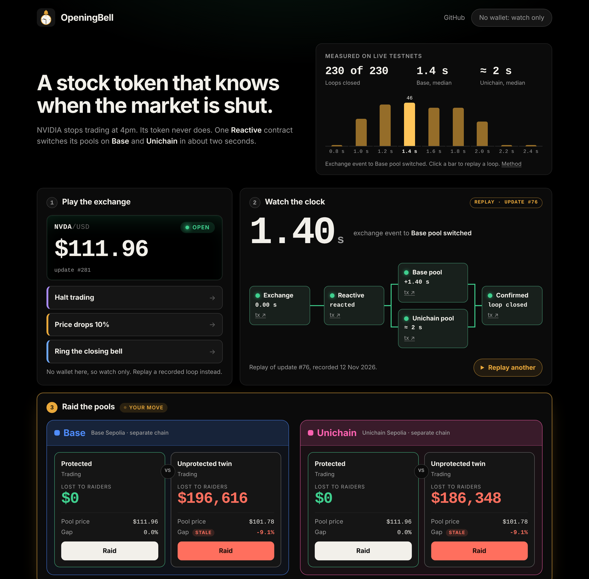
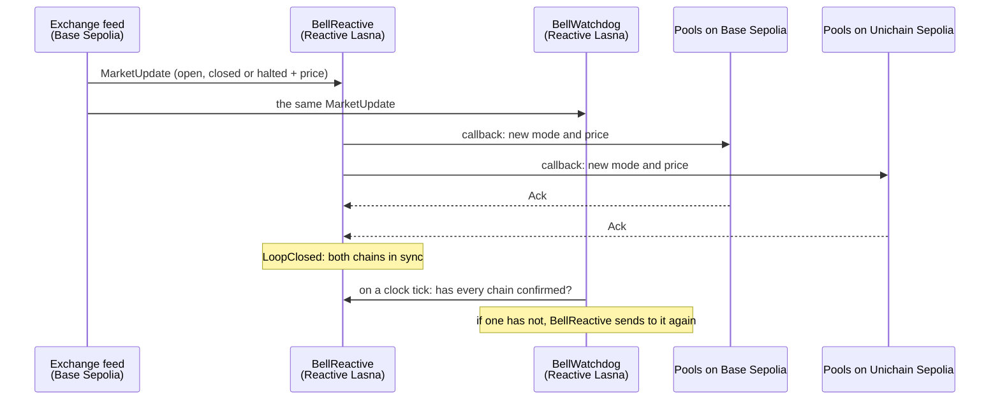

# OpeningBell

**Tokenized stocks that keep market hours, on every chain at once.**

A share of NVIDIA stops trading at 4pm New York time. A token that tracks NVIDIA does not. Every
close, trading halt and overnight gap leaves the token's on-chain pools at a price that is no longer
true, and the first bot to notice trades against them and keeps the difference. The people who
supplied the pool pay for it. When the token trades on several chains, every chain is exposed at the
same moment.

OpeningBell puts the stock exchange's hours on-chain. A Reactive Network contract watches the
exchange's state and, in a single reactive transaction, switches the token's pools on Base Sepolia
and Unichain Sepolia into the right mode: re-priced the moment the market reopens, refusing swaps
during a halt, wide and expensive after hours. A second Reactive contract, the watchdog, checks that
every chain confirmed, and re-sends by itself to one that did not.

Built for the Reactive Omni Buildathon, track **Every Second Counts**.

Live on Base Sepolia, Unichain Sepolia and Reactive Lasna. Over 230 market updates on the live
testnets, the Base pool switched a median of **1.4 s** after the exchange event (2.4 s at worst), the
Unichain pool about **2 s** after, and **230 of 230** loops closed. See [Speed](#speed).

**[Play the demo](https://openingbell-two.vercel.app)** with any wallet and a little test ETH.

[](https://openingbell-two.vercel.app)

<!-- TODO: add the video link here once it exists: **[Watch the video](VIDEO_LINK)** -->

## How it works



1. **`MarketFeed`** (Base Sepolia) publishes the reference market's state: open, closed or halted,
   plus the reference price. Nobody publishes equity prices on a testnet, so in the demo the
   exchange is played by `DemoStage`: prices start at $140 and move when someone presses an exchange
   button. In production the feed is replaced by an existing equity feed; the rest of the system
   only depends on the `MarketUpdate` event.
2. **`BellReactive`** (Reactive Lasna) subscribes to the feed. For each update it decides what every
   venue should do and sends one callback per venue chain from the same reactive transaction.
3. On each venue chain, **`BellGuard`** records the state (it accepts writes only through Reactive
   Network's callback proxy, and only from our `BellReactive`), **`BellVault`** pulls the pool's liquidity, moves the empty pool to the
   new price and puts the liquidity back in a band around it, and **`BellHook`**, a Uniswap v4 hook,
   applies the mode to every swap.
4. Each guard confirms with an `Ack` event, which `BellReactive` also subscribes to. When every venue
   has confirmed, it emits `LoopClosed`: an on-chain record that all chains agree.
5. **`BellWatchdog`** (Reactive Lasna) makes sure the loop closes. It hears the same update, switches on
   the network's own clock (`Cron10`, one event every ten blocks) and looks at `BellReactive`'s books
   on the next tick. A venue that still owes a confirmation eight blocks after the send is sent the
   state again, up to three rounds, with nobody pressing anything. Once every loop is closed the
   watchdog unsubscribes from the clock, so a quiet market costs nothing.

| Exchange state | Swaps | Fee | Liquidity band |
| --- | --- | --- | --- |
| Open | allowed | 0.05% | ±2% around the reference price |
| Closed (after hours, weekends) | allowed | 3% | ±15% |
| Halted | refused | | |

## The demo: play the villain

Each venue chain has two identical Uniswap v4 pools of the pretend stock token. One is protected by
OpeningBell. The other, the *twin*, ignores market hours, as most pools do today.

1. **Play the exchange.** Halt trading, ring the closing bell, or reopen 10% higher or lower.
2. **Watch the stopwatch.** Every hop of the loop appears with its transaction, timed from block
   timestamps.
3. **Raid a pool.** `Arena.raid()` does in one transaction what an arbitrage bot does: it trades
   against the pool until the pool's price matches the real one and keeps the difference. It uses
   play money minted for the occasion, so any wallet can play with no tokens or approvals.

No wallet? The chart at the top of the page holds every loop of the benchmark below. Click a bar and
one of those loops replays on the stopwatch, with a link to each of its real transactions.

Live on the testnets on 12 November 2026, played from a fresh wallet through the demo page: trading
was halted at $138.94 and resumed 10% lower at $125.05. The twins were still quoting $140.00, and one
raid took **$13,577.95 from the twin on each chain**. The same raid on the protected pools found
nothing to take: they were already at the new price.

| | Base Sepolia | Unichain Sepolia |
| --- | --- | --- |
| Raid on the twin | [$13,577.95 taken](https://sepolia.basescan.org/tx/0x2112a21b98413ae139ba3c950a3d9381c2b616488c2d7c5a262dfa28cd2261f3) | [$13,577.95 taken](https://sepolia.uniscan.xyz/tx/0xb5c157087eca20fa340441d9788ce2cf3a7fbcf06fd59a689ab2681eea9ad2f7) |
| Raid on the protected pool | [nothing to take](https://sepolia.basescan.org/tx/0x7b2db110a9cb6c785443b0d1692a91df873b4080ee8d1362e6ecde830ec15fb5) | [nothing to take](https://sepolia.uniscan.xyz/tx/0x80e6ee85f48695e2badffa3ef01568500dcc725bcdc5e870c16fa56bfb870656) |

Exchange actions are shared by everyone and rate-limited (one every 15 seconds, 100 a day), because
each one costs the project testnet funds on Reactive Network. Playing needs a little test ETH for gas
on Base Sepolia or Unichain Sepolia, for example from the [Superchain faucet](https://app.optimism.io/faucet).

## Speed

`tools/src/bench.ts` plays many market updates on the live testnets and times each loop from
on-chain records only:

- **Exchange event → Base pool switched** uses Base Sepolia's millisecond block timestamps. Both ends
  are on the same chain and clock, so the number is exact to the 200 ms block.
- **Exchange event → Unichain pool switched** compares two chains' clocks. Unichain only has whole
  seconds, so this hop is good to about a second.
- **Reaction → both pools confirmed** is counted in Lasna blocks. Lasna's clock runs about a second
  behind the others, so it is never subtracted from another chain's clock.

Live run, 12 November 2026: 200 market updates (67 halts, 67 resumes at a new price, 66 price
moves while open). **200 of 200 loops closed.**

| Hop | p50 | p90 | max | min | Clock |
| --- | --- | --- | --- | --- | --- |
| Exchange event → Base Sepolia pool switched | **1.40 s** | 2.00 s | 2.40 s | 1.00 s | Base Sepolia block times in ms |
| Exchange event → Unichain Sepolia pool switched | **≈2 s** | ≈3 s | ≈3 s | ≈1 s | whole seconds (±1 s) |
| Reaction → both pools confirmed | 2 Lasna blocks | 2 | 3 | 2 | Lasna blocks, about 1 s each |

A second run of 30 updates added the closing bell and the next day's open (6 of each, which the
first run's cycle skipped): Base p50 1.60 s, max 2.00 s, and 30 of 30 loops closed.

Full results are in [`bench/RESULTS.md`](bench/RESULTS.md), and every loop's transaction hashes are
in `bench/results/`.

## On-chain proof: three full loops

Each row is one market update, from the origin event to the callbacks and back.

| Update | Exchange event (Base Sepolia) | Reactive reacts (Lasna) | Pool switched (Base Sepolia) | Pool switched (Unichain Sepolia) | Both confirmed (Lasna) |
| --- | --- | --- | --- | --- | --- |
| Halt (update #4) | [origin](https://sepolia.basescan.org/tx/0x897768526e96f342566524cb9f7e3122b6537f75822556f0d78b15581093e2b3) | [reactive tx](https://lasna.reactscan.net/tx/0xe31c145252dbca98234c90b938704e7cda9db9f459136da4701edc30c774a81d) | [callback](https://sepolia.basescan.org/tx/0xc1bf64cf6243455897a90dff257987a54f1f6cda57ee4fb0d9d24ce01a2339a9) | [callback](https://sepolia.uniscan.xyz/tx/0x903a79517951fcaabf74de27d6733a3565b3c17eee221094562df210af8471af) | [loop closed](https://lasna.reactscan.net/tx/0xa7507db51f9ce502dfdc41806cb98bf90082fb8ab8e230c23454dc85d6d237e2) |
| Resume 1% lower (update #5) | [origin](https://sepolia.basescan.org/tx/0xeea27f0b2f2cef9254fbb986452a48d2542ec45545b06adf7bde58b56cf62f05) | [reactive tx](https://lasna.reactscan.net/tx/0x40de9bfc4d897c5d4310b290af61c8b4cb970779be6e3db3acd949380e52a4f4) | [callback](https://sepolia.basescan.org/tx/0xf31c62e812c30bed894df0610bcdb1aafd8de857a26a7eea80374cf0a664dddb) | [callback](https://sepolia.uniscan.xyz/tx/0x166dbce255dbad7b7ddf15769d805e782661bd694fcdf5a3b55aab8ecf54f2a3) | [loop closed](https://lasna.reactscan.net/tx/0x27f7580c6dda639a41a377a597d97dc7406011a0ef148b96b4e1176901738ef5) |
| Closing bell (update #206) | [origin](https://sepolia.basescan.org/tx/0x5fb8c0815d2621810c599f1de3ac9edbb7735b39d49ee960bb58addae2b2024c) | [reactive tx](https://lasna.reactscan.net/tx/0xedb35dc6582236d0b658fbbbd4a352ee87ec09a08f996571fbc3a7a7f49a9d5c) | [callback](https://sepolia.basescan.org/tx/0xfe6c085a2ceec12e303177306b360c7660fd0dd5c64ad2d15d7c5d50bb435598) | [callback](https://sepolia.uniscan.xyz/tx/0x4d5f93ae9a977020a8ada5f3544a18e8e9081829de3da4ad8f5cac2dcf4b81ce) | [loop closed](https://lasna.reactscan.net/tx/0x667b0f637013e1dbfecab2e88b17e29172abecf5a040d9673ba7d5dcb595fb9f) |

All 233 recorded loops are listed the same way in `bench/results/`.

## When a chain misses an update

A callback can fail: the venue chain is congested, the callback runs out of gas, the guard is out
of funds. Without a second look, that venue would stay on the old state until the next market
update. `BellWatchdog` is that second look, and it is a reactive contract too.

We broke one callback on purpose on the live testnets (15 November 2026, update #275, a resume after
a halt). The Unichain venue's callback gas was set to 100,000, far too little, for one update:

| Time (UTC) | What happened | Transaction |
| --- | --- | --- |
| 18:38:42 | The exchange resumes trading | [origin](https://sepolia.basescan.org/tx/0x14c3a2e7a0e868c2961a707ac6c86b14f9369d6cfcb832ea663d7b1d0ee823d2) |
| Lasna block 8429091 | `BellReactive` sends to both venues; `BellWatchdog` starts watching and switches the clock on | [reactive tx](https://lasna.reactscan.net/tx/0xe39b7622a22fef2e86780e3201fd77de65a48c299d9d2f63b927c2b4d19a88f6), [watchdog](https://lasna.reactscan.net/tx/0x6869bf6313f231bb5de6e9430598b6c55438af56305d544731ae7c363979755f) |
| Lasna block 8429092 | Base confirms | [ack](https://lasna.reactscan.net/tx/0xb83c9f943a33fd15acfb54f60aa8806ade2fee0d29232af5f47ea4a6100056ae) |
| 18:38:44 | The callback to Unichain fails: out of gas | [reverted](https://sepolia.uniscan.xyz/tx/0xbd34a68ba2b9f458c704a2f0020c52692c2e4644137632caf9f6f44889a66ef4) |
| Lasna block 8429101 | The clock ticks. The watchdog sees Unichain still owes a confirmation and has the conductor send again | [`Retried`](https://lasna.reactscan.net/tx/0x63e6f2398834a6256ea6092a9c7fd194d8f9350550c5fc53195be1cb0361b0e5) |
| 18:38:54 | The second callback lands on Unichain, ten seconds after the first one failed | [callback](https://sepolia.uniscan.xyz/tx/0x78fc1d2e278b59ad2539b471189181bf7ea95b2bb99f977e1a26fb9f905c3b44) |
| Lasna block 8429103 | Unichain confirms: `LoopClosed` | [loop closed](https://lasna.reactscan.net/tx/0x02bedad9705148bb8f5853b5de4c41a015d99712d9cfcae42463a27b13509c17) |
| Lasna block 8429111 | Next tick: the watchdog records `Settled` after one round and switches the clock off | [`Settled`](https://lasna.reactscan.net/tx/0xa47e565a8060ef8d0e7f7437388a11f6f719ad23369d302c2d4b41d3926a17ce) |

The gas limit was put back to 1,000,000 four seconds after the update
([setting it low](https://lasna.reactscan.net/tx/0x7992f13b113ad8ad93e6ad94ca7028800e2cabd89b5dd214a35b7cc2bfdff004),
[putting it back](https://lasna.reactscan.net/tx/0x64d2a5511daaaec983548c51e70df8344074cf25fc67354852ca1f859e74798e)).
Nobody called `resync`: the re-send came from the watchdog's own reactive transaction.

The demo page shows it when it happens: the late chain's box on the stopwatch gets a "2nd try" tag,
and the line under it says the watchdog had the update sent again.

What it does not do: if the venue is still broken after three rounds it emits `GaveUp` and stops, so
a dead venue cannot drain it. And it re-sends through `BellReactive`, so it has to own that
contract; the deployer still reaches every owner function through the watchdog's `execute`.

The benchmark in [Speed](#speed) was measured before the watchdog existed. It does not sit in the
path of the first callback, which still leaves in `BellReactive`'s own reactive transaction.

## Why Reactive

- A keeper bot per chain is off-chain and trusted, has to be run and funded on every chain
  separately, and leaves no on-chain proof that the chains agree.
- A price oracle read on each swap fixes the price but not the mode: it does not halt swaps, widen
  the band or move the liquidity away from the stale price.
- With Reactive, one on-chain decision reaches every venue chain from a single reactive transaction,
  and the confirmations come back to the same contract, which records `LoopClosed`.
- The safety net is on Reactive too. The watchdog's clock is a Reactive `Cron` event, it subscribes
  and unsubscribes from inside `react()`, and it reads and calls `BellReactive` directly because both
  live on Reactive Network. No keeper, no server.

## Live contracts

| Network | Contract | Address |
| --- | --- | --- |
| Base Sepolia | `MarketFeed` | `0x8ddc373617e2D83348fE72eAcF8C4ffB58e9C46E` |
| Base Sepolia | `DemoStage` | `0x5E61Ad5f07de8E8c6438036FC7315Ebf783c4Ba2` |
| Reactive Lasna | `BellReactive` | `0x8ddc373617e2D83348fE72eAcF8C4ffB58e9C46E` |
| Reactive Lasna | `BellWatchdog` | `0xF462b2cA056d52E762F3434789fDe040FE2964Eb` |
| Base Sepolia | `BellGuard` | `0xac2b5Be3B5208D8f5bC91BEd7465da46954e2CEE` |
| Base Sepolia | `BellHook` | `0x6E4b43f2B25851D0FAeDe788C41fc1B467e64880` |
| Base Sepolia | `BellVault` | `0xE5a33BfF43DDB8c1518B883A8662c245958cAAd5` |
| Base Sepolia | `Arena` | `0x3D783C81828EB1718143C0e84375B8F680982F04` |
| Unichain Sepolia | `BellGuard` | `0x8ddc373617e2D83348fE72eAcF8C4ffB58e9C46E` |
| Unichain Sepolia | `BellHook` | `0x2026BACF74615ca0c767b885C891067356E0C880` |
| Unichain Sepolia | `BellVault` | `0x513a29Ed7091BCF66490AcA9Dc04e52B3198142f` |
| Unichain Sepolia | `Arena` | `0xE5a33BfF43DDB8c1518B883A8662c245958cAAd5` |

Twin pools, tokens and pool ids are in [`deployments/`](deployments/).

## Honest limits

- **Two seconds is not zero.** OpeningBell shrinks the window from "until someone notices" to about
  two seconds, on every chain at once. A bot that trades in the same block as the news can still win
  that block. The after-hours fee and wide band make a closed market a poor place to bet on
  overnight news, which is where the largest gaps happen.
- **The feed is a stand-in.** In the demo, prices are set by whoever plays the exchange, not by a
  licensed exchange feed.
- **Testnets and play money only.** The stock token is a mock with no value.

## Repository

| Path | What it holds |
| --- | --- |
| `src/origin/` | `MarketFeed`, and `DemoStage`, which lets anyone play the exchange in the demo |
| `src/reactive/` | `BellReactive`, the conductor on Reactive Network, and `BellWatchdog`, which re-sends to a venue that never confirmed |
| `src/venue/` | `BellGuard`, `BellHook`, `BellVault`, `Arena`, `MockToken` and the price maths |
| `script/` | Deployment scripts, the same ones the local rehearsal uses |
| `test/` | Foundry tests, with a local simulator of Reactive Omni and the real Uniswap v4 PoolManager bytecode from Base Sepolia |
| `tools/` | Fork rehearsal, latency benchmark, loop watcher, and a local relay for trying the demo offline |
| `web/` | The demo page, a static build that Vercel deploys using `vercel.json` |

## Build, test and run

Needs [Foundry](https://book.getfoundry.sh/) and Node 20 or newer.

```sh
git clone --recurse-submodules https://github.com/mithunscodes/OpeningBell
cd OpeningBell
forge test                     # 101 tests
```

The whole system on local forks of all three networks, with no wallet and no testnet funds. A
local relay plays the part of the Reactive Network node, using the real system contract and
callback proxies on the forks:

```sh
(cd tools && npm install)
tools/rehearse.sh              # a trading day: open, halt, reopen lower, close, overnight gap
```

The demo page on local forks:

```sh
(cd web && npm install)
tools/serve-local.sh           # then open http://127.0.0.1:8080/?local
```

On the live testnets, with the deployer's key:

```sh
cd tools
npx tsx src/watch.ts                                         # print each loop as it happens
DEPLOYER_PRIVATE_KEY=0x... npx tsx src/bench.ts --rounds 100 # timed benchmark
```

## Costs

Measured over the live 200-update run:

- 0.046 lREACT per market update on Lasna, at its 100 gwei gas price. One update is three reactive
  transactions: the update itself and the two confirmations.
- The watchdog adds about 0.035 lREACT to a healthy update (one reactive transaction to start
  watching, one clock tick to see the loop closed) and paid 0.054 for the recovery above. It has its
  own balance and can be switched off with `setArmed(false)`.
- Each guard pays for its own callbacks through the callback proxy: about 0.0000022 ETH per update on
  Base Sepolia and 0.0000005 ETH on Unichain Sepolia at current testnet gas prices.

## Built with

[Reactive Network](https://reactive.network) Omni (`reactive-lib-omni`), Uniswap v4 (`v4-core`),
Foundry, viem.
