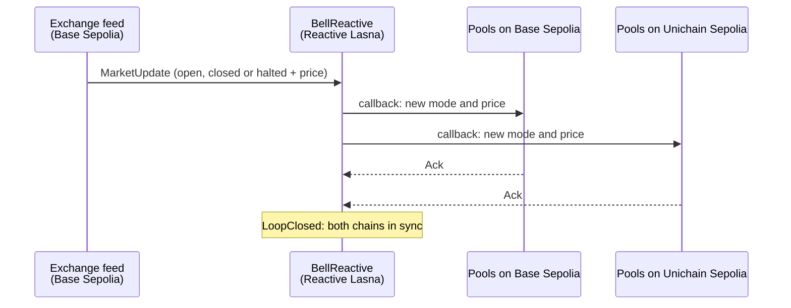

# OpeningBell

**Tokenized stocks that keep market hours, on every chain at once.**

A share of NVIDIA stops trading at 4pm New York time. A token that tracks NVIDIA does not. Every
close, trading halt and overnight gap leaves the token's on-chain pools at a price that is no longer
true, and the first bot to notice trades against them and keeps the difference. The people who
supplied the pool pay for it. When the token trades on several chains, every chain is exposed at the
same moment.

OpeningBell puts the stock exchange's hours on-chain. A Reactive Network contract watches the
exchange's state and, in a single reactive transaction, switches the token's pools on Base Sepolia
and Unichain Sepolia into the right mode: re-priced the moment the market reopens, refusing swaps
during a halt, wide and expensive after hours.

Built for the Reactive Omni Buildathon, track **Every Second Counts**.

## How it works



1. **`MarketFeed`** (Base Sepolia) publishes the reference market's state: open, closed or halted,
   plus the reference price. Nobody publishes equity prices on a testnet, so in the demo the
   exchange is played by `DemoStage`: prices start at $140 and move when someone presses an exchange
   button. In production the feed is replaced by an existing equity feed; the rest of the system
   only depends on the `MarketUpdate` event.
2. **`BellReactive`** (Reactive Lasna) subscribes to the feed. For each update it decides what every
   venue should do and sends one callback per venue chain from the same reactive transaction.
3. On each venue chain, **`BellGuard`** records the state (it accepts writes only through Reactive
   Network's callback proxy, and only from our `BellReactive`), **`BellVault`** pulls the pool's liquidity, moves the empty pool to the
   new price and puts the liquidity back in a band around it, and **`BellHook`**, a Uniswap v4 hook,
   applies the mode to every swap.
4. Each guard confirms with an `Ack` event, which `BellReactive` also subscribes to. When every venue
   has confirmed, it emits `LoopClosed`: an on-chain record that all chains agree.

| Exchange state | Swaps | Fee | Liquidity band |
| --- | --- | --- | --- |
| Open | allowed | 0.05% | ±2% around the reference price |
| Closed (after hours, weekends) | allowed | 3% | ±15% |
| Halted | refused | | |

## The demo: play the villain

Each venue chain has two identical Uniswap v4 pools of the pretend stock token. One is protected by
OpeningBell. The other, the *twin*, ignores market hours, as most pools do today.

1. **Play the exchange.** Halt trading, ring the closing bell, or reopen 10% higher or lower.
2. **Watch the stopwatch.** Every hop of the loop appears with its transaction, timed from block
   timestamps.
3. **Raid a pool.** `Arena.raid()` does in one transaction what an arbitrage bot does: it trades
   against the pool until the pool's price matches the real one and keeps the difference. It uses
   play money minted for the occasion, so any wallet can play with no tokens or approvals.

On local forks of the three networks, a halt followed by a reopen 10% lower let a raider take
$12,613 from the twin on each chain and nothing from the protected pools. Exchange actions are
shared by everyone and rate-limited (one every 15 seconds, 100 a day), because each one costs the
project testnet funds on Reactive Network.

The demo page link and the live contract addresses will be added here after the testnet deployment.

## Speed

`tools/src/bench.ts` plays many market updates on the live testnets and times each loop from
on-chain records only:

- **Exchange event → Base pool switched** uses Base Sepolia's millisecond block timestamps. Both ends
  are on the same chain and clock, so the number is exact to the 200 ms block.
- **Exchange event → Unichain pool switched** compares two chains' clocks. Unichain only has whole
  seconds, so this hop is good to about a second.
- **Reaction → both pools confirmed** is counted in Lasna blocks. Lasna's clock runs about a second
  behind the others, so it is never subtracted from another chain's clock.

Results go to [`bench/RESULTS.md`](bench/RESULTS.md), and every loop's transaction hashes go to
`bench/results/`. The live run has not happened yet; this section will carry its numbers.

## Honest limits

- **Two seconds is not zero.** OpeningBell shrinks the window from "until someone notices" to about
  two seconds, on every chain at once. A bot that trades in the same block as the news can still win
  that block. The after-hours fee and wide band make a closed market a poor place to bet on
  overnight news, which is where the largest gaps happen.
- **The feed is a stand-in.** In the demo, prices are set by whoever plays the exchange, not by a
  licensed exchange feed.
- **Testnets and play money only.** The stock token is a mock with no value.

## Repository

| Path | What it holds |
| --- | --- |
| `src/origin/` | `MarketFeed`, and `DemoStage`, which lets anyone play the exchange in the demo |
| `src/reactive/` | `BellReactive`, the contract on Reactive Network |
| `src/venue/` | `BellGuard`, `BellHook`, `BellVault`, `Arena`, `MockToken` and the price maths |
| `script/` | Deployment scripts, the same ones the local rehearsal uses |
| `test/` | Foundry tests, with a local simulator of Reactive Omni and the real Uniswap v4 PoolManager bytecode from Base Sepolia |
| `tools/` | Fork rehearsal, latency benchmark, loop watcher, and a local relay for trying the demo offline |
| `web/` | The demo page |

## Build, test and run

Needs [Foundry](https://book.getfoundry.sh/) and Node 20 or newer.

```sh
git clone --recurse-submodules https://github.com/mithunscodes/OpeningBell
cd OpeningBell
forge test                     # 75 tests
```

The whole system on local forks of all three networks, with no wallet and no testnet funds. A
local relay plays the part of the Reactive Network node, using the real system contract and
callback proxies on the forks:

```sh
(cd tools && npm install)
tools/rehearse.sh              # a trading day: open, halt, reopen lower, close, overnight gap
```

The demo page on local forks:

```sh
(cd web && npm install)
tools/serve-local.sh           # then open http://127.0.0.1:8080/?local
```

On the live testnets, with the deployer's key:

```sh
cd tools
npx tsx src/watch.ts                                         # print each loop as it happens
DEPLOYER_PRIVATE_KEY=0x... npx tsx src/bench.ts --rounds 100 # timed benchmark
```

## Costs

Measured on forks of the live networks:

- About 0.016 lREACT per reactive transaction at Lasna's 100 gwei gas price. One market update is
  three reactive transactions (the update and two confirmations), about 0.05 lREACT.
- Callbacks on Base Sepolia and Unichain Sepolia are paid from each guard's deposit with the callback
  proxy. Each callback uses 200k to 375k gas, a few millionths of an ETH at current testnet gas prices.

## Built with

[Reactive Network](https://reactive.network) Omni (`reactive-lib-omni`), Uniswap v4 (`v4-core`),
Foundry, viem.
