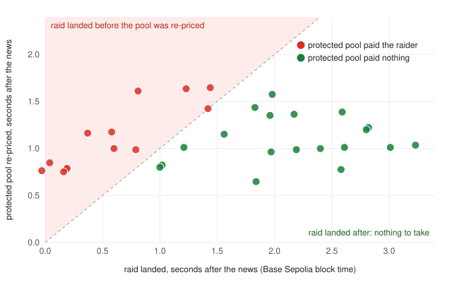

# Beat the bell: how fast does a raider have to be?

Live run on 23 November 2026 (Base Sepolia, Unichain Sepolia, Reactive Lasna). Raw data with every
transaction hash: [`results/2026-11-23-live.json`](results/2026-11-23-live.json). Script:
[`tools/src/race.ts`](../../tools/src/race.ts).

## Set-up

- A separate market id, `keccak256("NVDA/USD race")`, on the live feed, with its own pair of pools on
  Base Sepolia (`deployments/race-84532.json`). The demo market, pools and scoreboard are untouched.
  The conductor, the watchdog and the venue guards are the live ones, unchanged.
- The protected race pool is re-priced by the loop, exactly like the demo's protected pool. Its twin
  is re-priced by nobody.
- The raider is the fastest there can be: it reads the new price from the feed itself, on the same
  chain as the news, and its transactions are sent from the same account right behind the news
  (consecutive nonces), so it can land in the very same block.
- 32 attempts. Each one moves the price 5% (down, then up, alternating), then raids both pools after
  a set wait: 0.0, 0.2, 0.4 ... 3.0 s, twice each.
- After each raid both pools are topped up with play money, so every attempt starts with a full pool.
  That is also why the dollar size of a raid drifts between about $5,000 and $11,000.

## Result

| | Raids that paid | Total taken |
| --- | --- | --- |
| Protected pool | **13 of 32** | $87,040.46 |
| Twin pool (nobody re-prices it) | **32 of 32** | $189,039.06 |

- **Every raid that landed after the loop re-priced the protected pool got nothing: 19 of 19.**
- Every raid that landed before it paid: 12, plus one that landed in the same block as the re-price
  but ahead of it in the block (attempt 24).
- The loop re-priced the protected pool a median of **1.0 s** after the news (0.6 s fastest, 1.6 s
  slowest, Base Sepolia block times, which are exact to the 200 ms block). All 32 loops closed, and
  so did the set-up update before them.
- So: a raider that acts within about 0.8 s of the news always wins; one that takes longer than
  1.6 s never does; in between it depends on that update's loop.

## Every attempt

Times are on Base Sepolia's clock, counted from the block with the news.

| # | Raider waited | Raid landed | Pool safe | Protected pool | Twin pool | Raid tx |
| --- | --- | --- | --- | --- | --- | --- |
| 1 | 0.0 s | +0.0 s | +0.8 s | $5,536.41 taken | $5,536.41 taken | [raid](https://sepolia.basescan.org/tx/0xde379f06dcdaed2cd7cc81e5af509cdefe910a738de1d2491646316b03a79cdf) |
| 2 | 0.2 s | +0.2 s | +0.8 s | $5,443.86 taken | $5,443.86 taken | [raid](https://sepolia.basescan.org/tx/0xf9a970ea3a14909d6b0863c93899d808def9087d92d1fd103e17de6d1c6f12c8) |
| 3 | 0.4 s | +0.2 s | +0.8 s | $5,495.30 taken | $5,495.30 taken | [raid](https://sepolia.basescan.org/tx/0x61c7f259e65d8e4ca927ae1b71c9d34ee0342a96f11280dab974c418dbb48065) |
| 4 | 0.6 s | +0.6 s | +1.0 s | $5,299.38 taken | $5,299.38 taken | [raid](https://sepolia.basescan.org/tx/0x2aa54566ac619ac8802d9410fbe4b79157008ec8ae21d2c5b478da8db6a6e493) |
| 5 | 0.8 s | +0.8 s | +1.6 s | $5,717.87 taken | $5,717.87 taken | [raid](https://sepolia.basescan.org/tx/0xd652f35dffa1a4db38da4bb956a717341831bc3a6f8d208d2f81eb0121231fbb) |
| 6 | 1.0 s | +1.0 s | +0.8 s | **nothing** | $5,446.84 taken | [raid](https://sepolia.basescan.org/tx/0x99ee1b31412804caa33e466f5fbe817a1cd224b2949aabe8b9c14518dcb53636) |
| 7 | 1.2 s | +1.2 s | +1.6 s | $5,570.67 taken | $5,466.42 taken | [raid](https://sepolia.basescan.org/tx/0xb531e3438ad6334efa642784078f8bb9aea0f25d6a511196383928685407eb7d) |
| 8 | 1.4 s | +1.4 s | +1.6 s | $5,223.58 taken | $5,333.10 taken | [raid](https://sepolia.basescan.org/tx/0xc744e0ea21c2011cb99baf7054f73e38f5913286fa6be2e925a0bf3192138503) |
| 9 | 1.6 s | +1.6 s | +1.2 s | **nothing** | $5,686.17 taken | [raid](https://sepolia.basescan.org/tx/0x4aad33aec0e7f7358bb4b0c673a75bf28d9ad4ad1ed26040476c567e082acf8d) |
| 10 | 1.8 s | +2.0 s | +1.0 s | **nothing** | $5,449.83 taken | [raid](https://sepolia.basescan.org/tx/0x2a7ba7cf3753aed6fd8a9d23d36737cbc12a0f47bcf477a74542f00456464add) |
| 11 | 2.0 s | +2.0 s | +1.6 s | **nothing** | $5,434.53 taken | [raid](https://sepolia.basescan.org/tx/0x8eede290c279eb3965fbc44d52dfb94cfa89d62984174cd6fd1514f446521f38) |
| 12 | 2.2 s | +2.2 s | +1.0 s | **nothing** | $5,369.67 taken | [raid](https://sepolia.basescan.org/tx/0xc1b03f44a62719970c80bc295139e7eb55216d5694e2c4dce3eaa6a50b2f6fa6) |
| 13 | 2.4 s | +2.4 s | +1.0 s | **nothing** | $5,654.65 taken | [raid](https://sepolia.basescan.org/tx/0xd585df49816655ff2bf8bf935a82ef569bbb00295c6478ccaa7abd10fe8620a1) |
| 14 | 2.6 s | +2.6 s | +1.0 s | **nothing** | $5,452.82 taken | [raid](https://sepolia.basescan.org/tx/0x21f7a0c83f5cee0822d24d9eee91479f4709986ffa83f85388036dfb68a0d4da) |
| 15 | 2.8 s | +2.8 s | +1.2 s | **nothing** | $5,404.40 taken | [raid](https://sepolia.basescan.org/tx/0xa91215b696090bba556c78336311c400fda61115cc08829b2c7154d9d432142d) |
| 16 | 3.0 s | +3.2 s | +1.0 s | **nothing** | $5,404.63 taken | [raid](https://sepolia.basescan.org/tx/0xbea31c3a60f78fea7558422f4c12ff2381d73eb4639f3df9de008a23bb674f8b) |
| 17 | 0.0 s | +0.0 s | +0.8 s | $10,826.12 taken | $5,623.30 taken | [raid](https://sepolia.basescan.org/tx/0x107d5f3222a35e77943bfc3d49bc9b09a238a2bb2d6af7ee206b499153fbcfd6) |
| 18 | 0.2 s | +0.2 s | +0.8 s | $5,455.80 taken | $5,489.85 taken | [raid](https://sepolia.basescan.org/tx/0xbd5d0cd4fe2b17b7685a5ad4824c527b23443ca1f3b59217f51b47a1c57121a9) |
| 19 | 0.4 s | +0.4 s | +1.2 s | $11,167.17 taken | $5,374.44 taken | [raid](https://sepolia.basescan.org/tx/0x9963f365f109f04fbec788f411694c9bc15724090ddc4e0abc5c6de15ab40c85) |
| 20 | 0.6 s | +0.6 s | +1.2 s | $5,232.19 taken | $5,504.91 taken | [raid](https://sepolia.basescan.org/tx/0xf40c72eee2c3b91ca21a0a583d568c1ac6c8d301c10392655f6d4dbd648c3988) |
| 21 | 0.8 s | +0.8 s | +1.0 s | $10,837.07 taken | $5,592.12 taken | [raid](https://sepolia.basescan.org/tx/0x570766ae3c21a3a2bd378e2a5f0e70323f8bc0e42cc9e9b2753db82f2ddd5d28) |
| 22 | 1.0 s | +1.0 s | +0.8 s | **nothing** | $5,726.11 taken | [raid](https://sepolia.basescan.org/tx/0xd50e5944d72b79e1f0dc6366c591f9009966c7ba74e4c35f322873c51ed8573d) |
| 23 | 1.2 s | +1.2 s | +1.0 s | **nothing** | $5,344.64 taken | [raid](https://sepolia.basescan.org/tx/0x003a3bcfb0590a051ba0eb1fd657963c362a13fa53c6d810a5c9ca5b6277ecdf) |
| 24 | 1.4 s | +1.4 s | +1.4 s | $5,235.06 taken | $5,988.14 taken | [raid](https://sepolia.basescan.org/tx/0xbf51f4c383e7cbbab705bb7ad73f4d950777ac5024622dda95c76b4931843cdc) |
| 25 | 1.6 s | +1.8 s | +1.4 s | **nothing** | $5,561.12 taken | [raid](https://sepolia.basescan.org/tx/0x1b985da88e9555fcfb5c52e6978ad487dfe7855b2a9b1e905c13de0476389e81) |
| 26 | 1.8 s | +1.8 s | +0.6 s | **nothing** | $6,744.34 taken | [raid](https://sepolia.basescan.org/tx/0xc8a108ec60c3b9faf7591c0b1f7f499839042e56add8ae71224b2cc6b0eb7bce) |
| 27 | 2.0 s | +2.0 s | +1.4 s | **nothing** | $5,315.01 taken | [raid](https://sepolia.basescan.org/tx/0x9b2573072aaf20bcf26f2ba1e5ec09cf67ad8c040886f3d3d59b3f355f294775) |
| 28 | 2.2 s | +2.2 s | +1.4 s | **nothing** | $7,975.46 taken | [raid](https://sepolia.basescan.org/tx/0x7613c2c7244e32552382ffabfa025c90c583ebade9b42fe43cbb83e6e2e45e93) |
| 29 | 2.4 s | +2.6 s | +0.8 s | **nothing** | $5,530.29 taken | [raid](https://sepolia.basescan.org/tx/0xf2f9040b7ca9cd61f9cb031fa08f153affbd445fcc47306e07f2740a56d509bd) |
| 30 | 2.6 s | +2.6 s | +1.4 s | **nothing** | $10,300.56 taken | [raid](https://sepolia.basescan.org/tx/0xf32c5726c18618eb8d87415b7cbdda61309c081e5557f8b707a7c915a13d2fae) |
| 31 | 2.8 s | +2.8 s | +1.2 s | **nothing** | $5,285.54 taken | [raid](https://sepolia.basescan.org/tx/0x699c726ffb96b695e2249ac64f993f0e4882c47463cef38974d393d28f2934ba) |
| 32 | 3.0 s | +3.0 s | +1.0 s | **nothing** | $10,087.35 taken | [raid](https://sepolia.basescan.org/tx/0xcf2996c38afd9db4cee69975718352edd15431008dbe3bd6b944a1e4b86906a8) |

## One loop, end to end

Attempt 1, raid in the same block as the news (paid), and attempt 6, raid 1.0 s after the news
(nothing):

| Attempt | News (Base Sepolia) | Reactive reacts (Lasna) | Protected pool re-priced (Base Sepolia) | Unichain guard updated | Both confirmed (Lasna) | Raid on the protected pool |
| --- | --- | --- | --- | --- | --- | --- |
| 1 | [news](https://sepolia.basescan.org/tx/0xb9c2f5f6ba12b15c0f7abf3b59ccbe2351d131e7bd7743d4eff8837444bd456e) | [reactive tx](https://lasna.reactscan.net/tx/0xe2fcc5c1a2eb1b322aa5ed61df20c4e0d99621ff0ba58d52434e11444d351265) | [callback, +0.8 s](https://sepolia.basescan.org/tx/0xe4e1055349ce8347c35582b3638c0da420980e687e632b92cb81e7ac73fbe78d) | [callback](https://sepolia.uniscan.xyz/tx/0x305ff7324e149f83f08ceb48eaa4d849ce40a248ad48dd0885119531dcabf99a) | [loop closed](https://lasna.reactscan.net/tx/0x8cec93f71af5957eb834baf73c80a474588c204ccc6bf2e5ff4145003b80acc8) | [+0.0 s, $5,536.41 taken](https://sepolia.basescan.org/tx/0xde379f06dcdaed2cd7cc81e5af509cdefe910a738de1d2491646316b03a79cdf) |
| 6 | [news](https://sepolia.basescan.org/tx/0x1a94fba2f6841ea06cc80d1e48c375abbc8c2fd079c3eaedd9524359796728b8) | [reactive tx](https://lasna.reactscan.net/tx/0x3e72d93fa11bc9fd0217fbcee03c2d0728784e2deafe8e17e0e44911ef6d25fa) | [callback, +0.8 s](https://sepolia.basescan.org/tx/0xeecf955cb99a090f0d19079e82223e1071a1c0a970bd1f23910541ceb26b68f0) | [callback](https://sepolia.uniscan.xyz/tx/0xbe5ece82db68ed1c62710c43537a7a54e27cf9b21a91e922efa846ce52e682af) | [loop closed](https://lasna.reactscan.net/tx/0x0ed1c9a14af19068befecd97c7a5936e06e463d2e1f0b56ecbcaa31508ff14eb) | [+1.0 s, nothing](https://sepolia.basescan.org/tx/0x99ee1b31412804caa33e466f5fbe817a1cd224b2949aabe8b9c14518dcb53636) |

## Cost

33 market updates (one set-up, 32 attempts): 1.54 lREACT from the conductor and 0.67 lREACT from the
watchdog, about 0.067 lREACT per update in all. The race contracts and 64 raids cost about 0.0003
test ETH on Base Sepolia.
